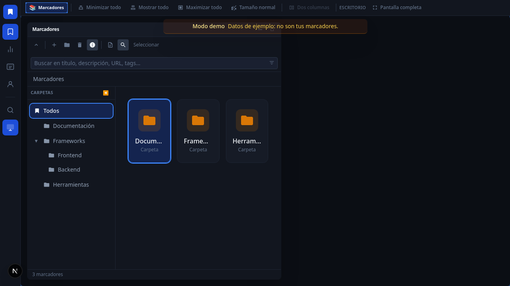

<p align="center">
  <a href="README.md">Español</a> · <a href="README.en.md">English</a>
</p>

<h1 align="center">Marcadores</h1>

<p align="center">
  
</p>

<p align="center">Marcadores en carpetas, con modo demo y Supabase.</p>

App pública para ordenar enlaces. Sin `.env.local` arranca en memoria. El sitio publicado está en [web-marcadores.vercel.app](https://web-marcadores.vercel.app).

<p align="center">
  <a href="https://github.com/FraVelz/WEB-Marcadores/actions/workflows/ci.yml"></a>
</p>

<p align="center">
  <a href="https://skillicons.dev">
    <picture>
      <source media="(prefers-color-scheme: dark)" srcset="https://skillicons.dev/icons?i=nextjs,react,ts,supabase,tailwind,pnpm&theme=dark&perline=6">
      <source media="(prefers-color-scheme: light)" srcset="https://skillicons.dev/icons?i=nextjs,react,ts,supabase,tailwind,pnpm&theme=light&perline=6">
      
    </picture>
  </a>
</p>

## ✨ Características

- Carpetas, cuadrícula y papelera de 30 días.
- Modo demo sin Supabase.
- Atajos, estadísticas y perfil.
- CI y pruebas en el repositorio.

> [!NOTE]
> La licencia no está en el repositorio. Ese archivo es el hueco si quieres mostrarlo en serio.

## 🛠️ Tecnologías

- **Next.js y React** — la aplicación.
- **Supabase** — sesión y datos cuando hay entorno.
- **pnpm** — instalación y scripts.

## 🚀 Inicio rápido

```bash
pnpm install
pnpm dev
```

> [!IMPORTANT]
> `pnpm test` es la prueba del repo. CI corre el workflow `ci.yml`.

## 📖 Uso

Sin credenciales, entra por el modo demo. Con Supabase, copia `.env.example` a `.env.local` y vuelve a arrancar.

> [!TIP]
> `pnpm lint` y `pnpm test` son los dos comandos que conviene pasar antes de un cambio.

## 🤝 Contribuir

Repositorio de [FraVelz](https://github.com/FraVelz). No hay `CONTRIBUTING.md`.

> [!WARNING]
> No subas `.env.local`. El ejemplo versionado es `.env.example`.

## 📄 Licencia

Este repositorio no incluye un archivo de licencia.
